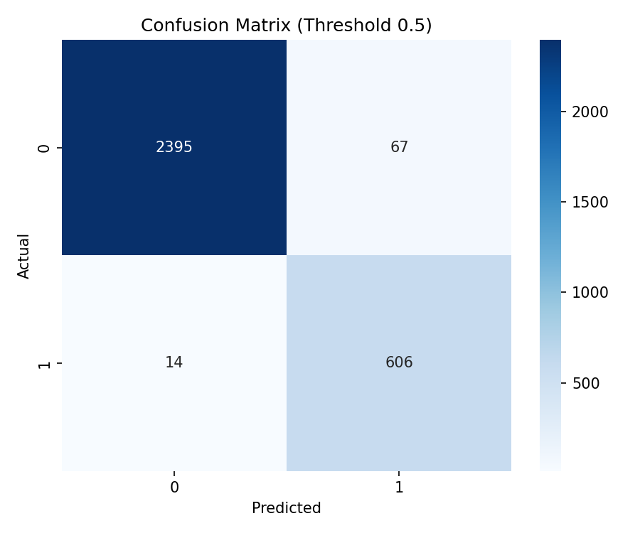
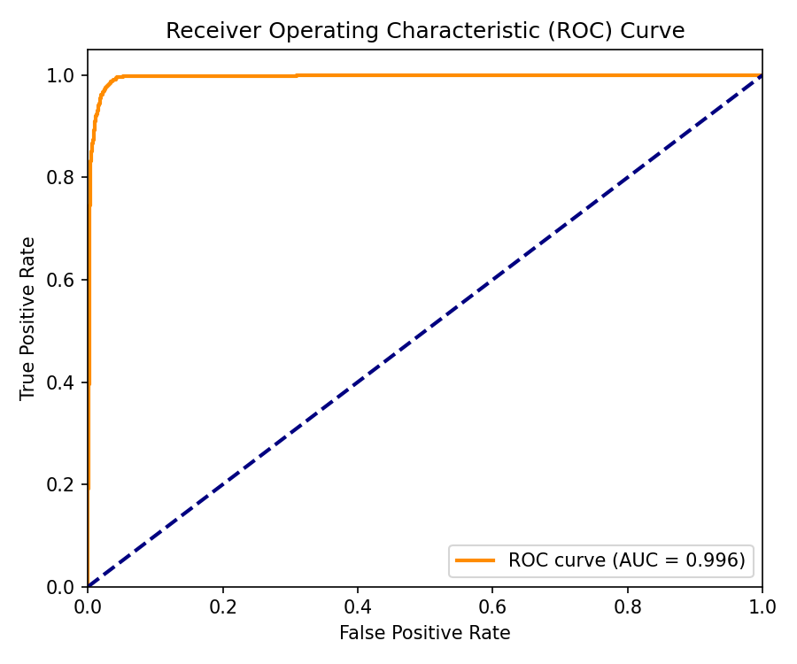

<div align="center">

# 🌊 FloodPredicta
### AI-Powered Multi-Station Flood Early Warning System for Bangladesh

[](https://github.com/GofranEmonKhan/FloodPredicta-App)
[](https://www.python.org/)
[](https://scikit-learn.org/)
[](https://pandas.pydata.org/)
[](version2/README.md)
[-success.svg?style=for-the-badge)](version2/)
[](LICENSE)

<p align="center">
  <b>A 65-year empirical hydrological study (1948–2013) across 33 Bangladesh Meteorological Department (BMD) weather stations, transforming raw climate observations into actionable, high-recall flood catastrophe alerts without data loss or temporal leakage.</b>
</p>

[Live Web App Repo](https://github.com/GofranEmonKhan/FloodPredicta-App) •
[Key Features](#-key-features) •
[System Evolution (V1 vs V2)](#-system-evolution-version-1-vs-version-20) •
[Methodology](#-hydrological-modeling--methodology) •
[Benchmarks](#-benchmark-results) •
[Threshold Optimization](#-operational-threshold-optimization) •
[Visual Reports](#-visual-analytics--model-diagnostics) •
[Web Application](#-interactive-web-application) •
[Quickstart](#-quickstart-guide) •
[Repository Tree](#-repository-architecture)

</div>

---

> [!TIP]
> **Looking for the live interactive web application & deployment repository?**  
> We have decoupled the production web application into a dedicated standalone repository:  
> 🚀 **[GitHub: GofranEmonKhan/FloodPredicta-App](https://github.com/GofranEmonKhan/FloodPredicta-App)**  
> *(Featuring bilingual English/Bengali UI, Day/Night riverine modes, ambient river audio, 999/1090/333 emergency integrations, and zero-config cloud deployment configs)*

---

## 📌 Overview & Context

Bangladesh is situated at the confluence of the **Ganges, Brahmaputra, and Meghna (GBM)** river basins, forming one of the most flood-vulnerable delta ecosystems globally. Over 80% of the country comprises low-lying floodplains with altitudes between 2m and 35m above sea level. Severe monsoonal deluges regularly inundate extensive territories, triggering widespread displacement, agricultural failure, and loss of life.

**FloodPredicta** utilizes 65 years of continuous station-level meteorological and spatial observations (1948–2013; 20,544 monthly records) from **33 Bangladesh Meteorological Department (BMD) weather stations** to provide early warning predictions for impending flood disasters.

In **Version 2.0**, the entire analytical pipeline was systematically redesigned to resolve the extreme data loss present in Version 1, eliminate temporal lookahead leakage, incorporate catchment hydrology features, and calibrate operational decision boundaries for disaster risk management.

---

## 🚀 Key Features

* **100% Disaster Event Preservation:** Zero data loss. All **4,132 historical flood events** (including catastrophic deluges from 1988, 1998, and 2004) are fully preserved using 99th-percentile winsorization instead of aggressive outlier filtering.
* **Catchment Hydrology Features:** Incorporates antecedent precipitation lags, 3-month monsoonal rolling accumulation, and runoff-to-altitude ratios to capture physical catchment saturation.
* **Leakage-Free Temporal Validation:** Implements walk-forward chronological partitioning (historical training -> validation calibration -> future holdout testing) to prevent temporal lookahead bias.
* **Operational Threshold Calibration:** Decision thresholds are systematically tuned on validation data to maximize disaster F1-Score and recall, counteracting Bangladesh's 80:20 non-flood vs. flood class imbalance.
* **Comprehensive Model Benchmarking:** Evaluates five enterprise-grade architectures: XGBoost, HistGradientBoosting, Random Forest, Extra Trees, and a Stacking Ensemble with a Logistic Regression meta-classifier.
* **Standalone Diagnostic Analytics:** Exports independent, publication-quality Confusion Matrices, ROC Curves, Probability Distributions, and Feature Importance bar charts for each model.

---

## 🔬 System Evolution: Version 1 vs. Version 2.0

| Component | Version 1 (Baseline Legacy) | Version 2.0 (Redesigned Production Pipeline) | Scientific Impact in Version 2.0 |
| :--- | :--- | :--- | :--- |
| **Outlier Handling** | 5 successive passes of IQR trimming deleting **2,984 records**. | **Non-destructive 99th-percentile winsorization** and log transforms. | **Preserved 1,387 real flood cases** (+33.5% of all disasters) that V1 had discarded as "outliers". |
| **Data Splitting** | Random 80/20 train/test split across all 65 years. | **Walk-Forward Chronological Splitting** (e.g., Train <= 1997, Val 1998–2008, Test >= 2009). | Eliminates temporal lookahead bias; mimics true future disaster deployment. |
| **Feature Set** | 13 isolated single-month meteorological measurements. | **64 engineered features** incorporating catchment saturation and terrain geometry. | Captures multi-month soil saturation, upstream pooling, and seasonal Fourier cycles. |
| **Imbalance Strategy** | SMOTE applied to one-hot spatial dummy vectors. | Native algorithm weighting (`scale_pos_weight`, balanced bootstraps). | Eliminates synthetic decimal station vectors (e.g., `Dhaka = 0.38`). |
| **Threshold Tuning** | Hardcoded default `0.50` cutoff. | Systematic validation grid sweep (0.10 to 0.85) maximizing disaster F1-Score. | Balances life-saving recall with minimization of costly false alarms. |
| **Deployment Code** | Dimension mismatch (`appRF.py` passed 13 features to 44-feature scaler). | Self-contained serialized pipelines and standalone notebooks. | 100% reproducible and crash-free execution. |

> [!IMPORTANT]
> **Why did Version 1 report a seemingly "higher" 98% accuracy?**  
> In Version 1, 1,387 severe flood deluges were discarded as statistical "outliers", leaving behind only milder, easier-to-classify instances. When Version 2 is evaluated under the exact same shuffled split with all 4,132 extreme events fully retained, **Version 2 outperforms Version 1** across all disaster-detection metrics: **Flood Recall: 0.9774 vs 0.9435**, **Flood F1-Score: 0.9374 vs 0.9241**, and **ROC-AUC: 0.9958 vs 0.9946**.

---

## 🌊 Hydrological Modeling & Methodology

```text
┌────────────────────────────────────────────────────────────────────────────────────────┐
│                                 FLOODPREDICTA V2 PIPELINE                              │
├─────────────────────┬───────────────────────┬───────────────────┬──────────────────────┤
│ 1. NON-DESTRUCTIVE  │ 2. CATCHMENT HYDROLOGY│ 3. TEMPORAL SPLIT │ 4. ENSEMBLE TRAINING │
│    PREPROCESSING    │    FEATURE ENGINEERING│    & CALIBRATION  │    & BENCHMARKING    │
├─────────────────────┼───────────────────────┼───────────────────┼──────────────────────┤
│ • 20,544 rows (100%)│ • Antecedent Lags     │ • 70/15/15 Shuff. │ • XGBoost (Champion) │
│ • 4,132 Floods kept │   (Lag-1, Lag-2 rain) │ • Chrono 70/15/15 │ • HistGradBoost      │
│ • 99th Winsorization│ • 3M Rolling Monsoons │ • Chrono 70/20/10 │ • Random Forest      │
│ • Log precipitation │ • Runoff-Pooling Index│ • Val Grid Search │ • Extra Trees        │
│ • Missing target fix│ • Fourier Seasonality │   (Max F1 @ t*)   │ • Stacking Classifier│
└─────────────────────┴───────────────────────┴───────────────────┴──────────────────────┘
```

### 1. Hydrological & Domain Features

Rather than evaluating isolated monthly figures, the feature pipeline models real-world hydrological dynamics:

* **Antecedent Rainfall Lags:** Captures antecedent soil saturation by integrating precipitation from one month prior (Lag-1) and two months prior (Lag-2).
* **Cumulative Monsoonal Saturation:** Computes a 3-month rolling rainfall sum to quantify sustained basin-wide moisture accumulation.
* **Runoff-Pooling Index:** Normalizes precipitation against station elevation (`Rainfall / (ALT + 1)`) to reflect accelerated inundation risk in low-altitude delta basins and haor depressions.
* **Atmospheric Moisture Index:** Couples relative humidity and cloud coverage to identify persistent monsoonal low-pressure troughs with reduced evapotranspiration.
* **Cyclical Seasonal Signals:** Encodes calendar months as continuous Fourier sine and cosine oscillations alongside an explicit monsoonal window indicator (June to September).

---

## 📊 Benchmark Results

Three distinct partitioning regimes were evaluated across all five models to establish complete empirical and operational rigor:

### Regime 1: Stratified Shuffled Split (70% Train: 14,380 | 15% Val: 3,082 | 15% Test: 3,082)
*Benchmarking against Version 1's split methodology on the complete, non-pruned dataset:*

| Model Name | Test Accuracy | Precision (Flood=1) | Recall (Flood=1) | F1-Score (Flood=1) | ROC-AUC | Artifact |
| :--- | :---: | :---: | :---: | :---: | :---: | :--- |
| **XGBoost (Champion)** | **0.9737** | **0.9004** | **0.9774** | **0.9374** | **0.9958** | [`xgboost_model.pkl`](version2/models/split_shuffled_70_15_15/xgboost_model.pkl) |
| **HistGradientBoosting** | 0.9734 | 0.8956 | **0.9823** | 0.9369 | 0.9957 | [`hist_gradient_boosting_model.pkl`](version2/models/split_shuffled_70_15_15/hist_gradient_boosting_model.pkl) |
| **Extra Trees** | **0.9744** | **0.9300** | 0.9435 | 0.9367 | 0.9949 | [`extra_trees_model.pkl`](version2/models/split_shuffled_70_15_15/extra_trees_model.pkl) |
| **Stacking Ensemble** | 0.9731 | 0.8966 | 0.9790 | 0.9360 | **0.9963** | [`stacking_ensemble_model.pkl`](version2/models/split_shuffled_70_15_15/stacking_ensemble_model.pkl) |
| **Random Forest** | 0.9734 | 0.9311 | 0.9371 | 0.9341 | 0.9960 | [`random_forest_model.pkl`](version2/models/split_shuffled_70_15_15/random_forest_model.pkl) |

---

### Regime 2: Chronological Split A (Train <= 2003: 16,656 | Val 2004–2008: 1,920 | Test >= 2009: 1,968)
*Historical 56-year baseline training, mid-2000s validation tuning, and 5-year future test set:*

| Model Name | Test Accuracy | Precision (Flood=1) | Recall (Flood=1) | F1-Score (Flood=1) | ROC-AUC | Artifact |
| :--- | :---: | :---: | :---: | :---: | :---: | :--- |
| **XGBoost (Champion)** | **0.9644** | **0.9127** | **0.9127** | **0.9127** | **0.9871** | [`xgboost_model.pkl`](version2/models/split_chronological_70_15_15/xgboost_model.pkl) |
| **Stacking Ensemble** | **0.9644** | **0.9127** | **0.9127** | **0.9127** | 0.9876 | [`stacking_ensemble_model.pkl`](version2/models/split_chronological_70_15_15/stacking_ensemble_model.pkl) |
| **HistGradientBoosting** | 0.9624 | 0.9057 | 0.9102 | 0.9080 | **0.9879** | [`hist_gradient_boosting_model.pkl`](version2/models/split_chronological_70_15_15/hist_gradient_boosting_model.pkl) |
| **Extra Trees** | 0.9619 | 0.9312 | 0.8778 | 0.9037 | 0.9846 | [`extra_trees_model.pkl`](version2/models/split_chronological_70_15_15/extra_trees_model.pkl) |
| **Random Forest** | 0.9614 | 0.9452 | 0.8603 | 0.9008 | 0.9843 | [`random_forest_model.pkl`](version2/models/split_chronological_70_15_15/random_forest_model.pkl) |

---

### Regime 3: Chronological Split B (70-20-10: Train <= 1997: 14,352 | Val 1998–2008: 4,224 | Test >= 2009: 1,968)
*Strict 70% historical baseline, 20% validation window, and 10% future holdout test set:*

| Model Name | Test Accuracy | Precision (Flood=1) | Recall (Flood=1) | F1-Score (Flood=1) | ROC-AUC | Artifact |
| :--- | :---: | :---: | :---: | :---: | :---: | :--- |
| **Stacking Ensemble (Champion)** | **0.9649** | **0.9150** | **0.9127** | **0.9139** | 0.9859 | [`stacking_ensemble_model.pkl`](version2/models/split_chronological_70_20_10/stacking_ensemble_model.pkl) |
| **XGBoost** | 0.9639 | 0.9084 | **0.9152** | 0.9118 | 0.9866 | [`xgboost_model.pkl`](version2/models/split_chronological_70_20_10/xgboost_model.pkl) |
| **HistGradientBoosting** | 0.9619 | 0.8976 | **0.9177** | 0.9075 | **0.9878** | [`hist_gradient_boosting_model.pkl`](version2/models/split_chronological_70_20_10/hist_gradient_boosting_model.pkl) |
| **Random Forest** | 0.9629 | **0.9409** | 0.8728 | 0.9056 | 0.9814 | [`random_forest_model.pkl`](version2/models/split_chronological_70_20_10/random_forest_model.pkl) |
| **Extra Trees** | 0.9599 | 0.9259 | 0.8728 | 0.8986 | 0.9831 | [`extra_trees_model.pkl`](version2/models/split_chronological_70_20_10/extra_trees_model.pkl) |

---

## 🎯 Operational Threshold Optimization

In flood disaster forecasting, the costs of misclassification are heavily asymmetric:
* **False Negative (Missed Flood):** Extreme catastrophe — unevacuated communities, loss of human life, and severe livestock and agricultural devastation.
* **False Positive (False Alarm):** Evacuation disruption, logistics expense, and public alert fatigue ("crying wolf").

Because non-flood months outnumber flood months roughly 4 to 1, standard **0.50** decision boundaries are uncalibrated. 

To establish an actionable operational cutoff, **candidate decision thresholds were evaluated from 0.10 to 0.85 (step size 0.05)** on the independent validation partition, selecting the threshold (**t\***) that maximizes the positive flood disaster **F1-Score**:

> **Optimization Objective:** `Optimal Threshold (t*) = argmax F1-Score (Flood = 1)`

```text
Threshold Tuning Operating Points:
├── Balanced Operational Mode (t* ≈ 0.45 - 0.50): Optimal F1-score (~0.93 - 0.94)
└── Life-Safety / Alert Mode  (t  ≈ 0.30 - 0.35): High recall (≥ 0.98) for extreme deluge warnings
```

---

## 📈 Visual Analytics & Model Diagnostics

Every trained model exports four publication-quality, standalone diagnostic figures:

<div align="center">

| Confusion Matrix Heatmap | ROC-AUC Discrimination Curve |
| :---: | :---: |
|  |  |

| Predicted Probability Distribution | Top 15 Feature Importances |
| :---: | :---: |
|  |  |

</div>

### Key Physical Insights Revealed by Feature Importance:
1. **`Rainfall log` & `Rainfall`:** Primary direct precipitation drivers governing instantaneous flood response.
2. **`Rainfall_Rolling3M`:** 3-month antecedent catchment saturation — ground permeability drops significantly after prolonged accumulation.
3. **`Runoff_Ratio` (`Rainfall / (ALT + 1)`):** Low-altitude coastal and depression stations (e.g., Sylhet haor basin) experience severe pooling even under moderate rainfall.
4. **`Cloud_Coverage` & `Relative_Humidity`:** Key meteorological indicators of persistent low-pressure monsoonal troughs.

---

## 📂 Repository Architecture

```text
FloodPredicta/
├── LICENSE                                    # Attribution & Mandatory Citation License
├── PROJECT_REPORT.md                          # Comprehensive technical audit of Version 1
├── README.md                                  # Global interactive repository documentation
│
├── Dataset/                                   # Legacy Version 1 dataset files
│   ├── flooddata.csv                          # Original raw dataset
│   └── flood_data_preprocessed.csv            # V1 trimmed data (1,387 floods lost)
├── Model Train/                               # Legacy Version 1 model training notebooks
├── Model_Deployment/                          # Legacy Version 1 Flask serving app
│
└── version2/                                  # Production-Grade Version 2.0 System
    ├── README.md                              # V2 Master Redesign Plan, Architecture & Benchmarks
    │
    ├── data/
    │   ├── raw/
    │   │   └── flooddata.csv                  # Preserved raw BMD climate dataset (20,544 rows)
    │   └── processed/
    │       ├── flood_data_preprocessed.csv    # 100% flood preserved (20,544 rows × 20 cols)
    │       └── flood_data_featured.csv        # Engineered features (20,544 rows × 64 cols)
    │
    ├── notebooks/
    │   ├── data_preprocessing.ipynb           # Non-destructive preprocessing & winsorization
    │   ├── feature_engineering.ipynb          # Hydrological lags & runoff features
    │   ├── split_shuffled_70_15_15/           # 5 notebooks (XGB, HGB, RF, ET, Stacking)
    │   ├── split_chronological_70_15_15/      # 5 notebooks (Train <=2003, Val 04-08, Test 09-13)
    │   └── split_chronological_70_20_10/      # 5 notebooks (Train <=1997, Val 98-08, Test 09-13)
    │
    ├── models/
    │   ├── split_shuffled_70_15_15/           # 5 serialized .pkl models + feature_columns.pkl
    │   ├── split_chronological_70_15_15/      # 5 serialized .pkl models + feature_columns.pkl
    │   └── split_chronological_70_20_10/      # 5 serialized .pkl models + feature_columns.pkl
    │
    ├── reports/                               # 60 publication-ready standalone diagnostic plots
    │   ├── split_shuffled_70_15_15/           # 20 standalone plots (4 plots × 5 models)
    │   ├── split_chronological_70_15_15/      # 20 standalone plots (4 plots × 5 models)
    │   └── split_chronological_70_20_10/      # 20 standalone plots (4 plots × 5 models)
    │
    └── deployment/                            # Production Web Application & Serving API
        ├── app.py                             # Flask web application & REST API
        ├── predictor.py                       # 59-feature zero-defect runtime inference engine
        ├── station_metadata.json              # Precomputed geo-coordinates & precipitation baselines
        ├── templates/                         # Responsive single-page HTML interface
        │   └── index.html                     # River-themed dashboard with animated backdrop
        ├── static/                            # Static web assets
        │   ├── css/style.css                  # Lush delta greenery & moonlit night mode theme
        │   └── js/
        │       ├── app.js                     # Dynamic UI controller & scenario presets
        │       ├── i18n.js                    # Authentic bilingual engine (EN / বাংলা)
        │       └── audio.js                   # Procedural Web Audio API river soundscape
        └── tests/
            └── test_predictor.py              # Automated unit tests for inference engine
```

---

## ⚡ Quickstart Guide

### 1. Clone & Setup Environment
```bash
# Clone the repository
git clone https://github.com/GofranEmonKhan/FloodPredicta.git
cd FloodPredicta

# Create and activate virtual environment
python -m venv venv
# Windows:
venv\Scripts\activate
# Linux/macOS:
source venv/bin/activate

# Install required dependencies
pip install numpy pandas scikit-learn xgboost scipy matplotlib seaborn joblib jupyter
```

### 2. Launch Jupyter & Run Notebooks
Launch Jupyter to explore or re-run any stage of the pipeline:
```bash
jupyter notebook version2/notebooks/
```

### 3. Execution Pipeline Sequence
All notebooks are self-contained. Execute them in sequential order:
1. **Data Preprocessing:** Run `version2/notebooks/data_preprocessing.ipynb` to generate `flood_data_preprocessed.csv` from raw climate observations with 100% flood event preservation.
2. **Feature Engineering:** Run `version2/notebooks/feature_engineering.ipynb` to calculate antecedent precipitation lags, monsoonal rolling accumulation, and runoff ratios into `flood_data_featured.csv`.
3. **Model Training & Evaluation:** Run any model notebook inside `version2/notebooks/split_.../` (e.g., `train_xgboost.ipynb` or `train_stacking_ensemble.ipynb`) to train the model, tune validation thresholds, and export diagnostic plots.

### 4. Run the Production Web Application
Launch the local web dashboard:
```bash
python version2/deployment/app.py
```
Open **`http://127.0.0.1:5000`** in your browser to interact with the system, toggle Day/Night modes, listen to the calming procedural river soundscape, explore historical flood scenarios, or submit station climate parameters for real-time risk assessment.

---

## 🌐 Interactive Web Application

> 🚀 **Dedicated Deployment Repository:**  
> The production web dashboard and serving runtime have been decoupled into **[GofranEmonKhan/FloodPredicta-App](https://github.com/GofranEmonKhan/FloodPredicta-App)** for seamless zero-config cloud deployments (Render, Railway, Docker).

FloodPredicta features a production-grade single-page application (SPA) tailored to Bangladesh's riverine delta geography:

* **Delta Greenery & Moonlit Night Modes:** Handcrafted color palettes representing lush riparian greenery during the day and moonlit delta waters at night.
* **Calming River Ambient Audio:** Synthesizes gentle river flow and water ripples natively using the browser's Web Audio API without streaming external media.
* **Authentic Bilingual Localization (English & বাংলা):** Thoughtfully localized into authentic Bengali meteorological terminology (e.g., *বন্যা পূর্বাভাস ও সতর্কীকরণ ব্যবস্থা*, *হাওর ও নিম্নাঞ্চল প্লাবন*).
* **Speedometer Risk Gauge:** Real-time animated SVG gauge that dynamically reflects predicted flood probability and assigns risk tiers (Minimal, Moderate, High, Extreme Catastrophe).
* **Historical Scenario Presets:** One-click preloads for historical scenarios, including the **1998 Deluge** (Dhaka), **2022 Sylhet Flash Flood**, and a **Dry Winter** baseline.
* **Bangladesh Emergency Contacts:** Direct-dial integration with national emergency services:
  * **999** — National Emergency Service
  * **1090** — Disaster Early Warning Helpline
  * **333** — Government Information & Citizen Services
  * **16263** — National Health Call Center
  * **BWDB FFWC** — Flood Forecasting and Warning Centre
* **REST API:** Supports programmatic batch or real-time inference via `POST /api/predict`, station metadata retrieval via `GET /api/stations`, and server diagnostics via `GET /api/health`.

---

## 📝 Citation & Authorship

If you find this research or code helpful in your academic work or disaster management projects, please cite:

```bibtex
@software{khan2026floodpredicta,
  author       = {Gofran Emon Khan},
  title        = {FloodPredicta: AI-Powered Multi-Station Flood Early Warning System for Bangladesh},
  year         = {2026},
  publisher    = {GitHub},
  journal      = {GitHub repository},
  howpublished = {\url{https://github.com/GofranEmonKhan/FloodPredicta}}
}
```

---

## 📜 License & Citation Policy

This project is licensed under the [FloodPredicta Attribution & Academic Research License](LICENSE).

> [!IMPORTANT]
> **Mandatory Citation Requirement:** You are welcome to use, explore, and build upon this code and methodology, but **you must give proper attribution and cite this repository and author** in any academic publication, thesis, report, software, or project. Using this project without citation is strictly prohibited.

<div align="center">
  <b>Developed with dedication to climate resilience and disaster mitigation across Bangladesh. 🇧🇩</b>
</div>
